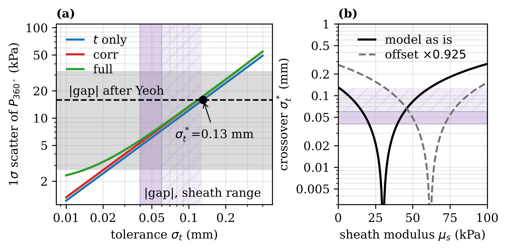

# soft-actuator-tolerance-analysis
Monte Carlo tolerance and sensitivity analysis comparing wall-thickness variations against modulus bias in a fiber-reinforced soft bending actuator model.

## Question

The analytical model gives the pressure *P(θ)* a fiber-reinforced bending actuator needs to reach bending angle *θ*. At 360° it matches the measured 207 kPa only with a calibrated modulus 43% above the small-strain value. A Yeoh wall and an outer sheath remove part of the difference; the remainder is a *systematic bias* (gap = P_exp − P_model).

Wall thickness also varies randomly from part to part. **After the Yeoh and sheath corrections, is the remaining gap larger or smaller than the pressure scatter caused by wall-thickness tolerance?** Bias and scatter are different kinds of quantity, so I define the crossover **σ_t\*** as the tolerance σ_t at which the 1σ pressure scatter equals |gap|.

## Main results

| Stage (360°) | P (kPa) | gap (kPa) | σ_t\* (mm), t only |
|---|---:|---:|---:|
| M0: Neo-Hookean, 0.22 MPa | 166.6 | +40.4 | 0.386 |
| M1: Yeoh | 191.1 | +15.9 | 0.131 |
| M2a: Yeoh + 25 kPa sheath | 204.3 | +2.7 | 0.022 |
| M2b: Yeoh + 39 kPa sheath | 211.7 | −4.7 | 0.037 |
| M2c: Yeoh + 92 kPa sheath | 239.7 | −32.7 | 0.246 |

- Measured part-to-part σ_t is 0.04–0.06 mm (McCall et al. 2024, three chambers thinner than 2 mm), so after Yeoh alone **bias dominates**.
- Whether tolerance dominates depends on the sheath. With the model as is, σ_t\* falls below the measured band only for a sheath modulus of about 21–40 kPa, where the gap changes sign.
- Scatter is almost linear in σ_t, so σ_t\* ≈ |gap|·t / (ε_t·P). The linearized value for Yeoh (0.1308 mm) matches the Monte Carlo (0.1307 mm).



## Caveats

- **Unexplained 8% offset.** This implementation gives 237.8 kPa at 360°, while the paper's analytical curve is about 220 kPa. I checked stress law, bottom width, moment arm, κ and length without finding the cause. If the offset were real, the tolerance-dominated window moves to about 53–72 kPa, which excludes the 25 and 39 kPa sheaths. The gap therefore may include an implementation difference.
- **The sheath is fitted, not derived.** The 39 kPa value was solved to reproduce an earlier estimate and has no material-data origin.
- Tolerances on *a*, *b*, *L* (0.1, 0.1, 1 mm) are assumed. The thickness reference rests on three chambers, and the 2 mm value is an extrapolation.
- Single uniform wall thickness per part; the paper's Fig. 10 geometries were not validated.

## Repository layout

```
code/fiber_model.py      vectorized model: pressure(), Neo-Hookean/Yeoh walls, sheath, Gauss-Legendre quadrature
code/run_analysis.py     model ladder, sensitivities, Monte Carlo sweep, crossover, figures
results/                 CSV outputs, figures, run_log.txt
report/                  3-page report (LaTeX + PDF), fig1.tex workflow diagram, project plan
demo/index.html          interactive demo (self-contained page)
```

## Reproduce

```bash
pip install -r requirements.txt
python code/run_analysis.py --out results     # about 45 s; N=20,000, seed 249
```

Options: `--n` (Monte Carlo samples) and `--seed`. With the defaults, every CSV in `results/` regenerates identically. Build the report with `pdflatex MAE249_MiniProject_Report.tex` (run twice, inside `report/`).

## Method in brief

- **Model.** *P(θ) = M(θ)/κ*, κ = (4a³ + 3πa²b)/6, axial stretch λ = rθ/L + 1, nested integration done with Gauss–Legendre quadrature (order 32 for validation, 12 for Monte Carlo). Baseline (a, b, t, L) = (8, 2, 2, 160) mm.
- **Materials.** Neo-Hookean *s = μ(λ − λ⁻³)*; Yeoh with C1 = 0.11, C2 = 0.02 MPa in the matching plane-strain form (I1 = λ² + 1 + λ⁻²).
- **Monte Carlo.** t ~ N(2, σ_t²), 25 log-spaced σ_t from 0.01 to 0.40 mm, same random draws at every σ_t. Variants: `t` only; `corr` (outer profile fixed by the mold, so a = a₀ − Δt); `full` (corr plus independent σ_a, σ_b, σ_L).
- **Sensitivity.** ±1% central differences of ln P in ln x.

## Demo

`demo/index.html` is a single self-contained page (no build step) that re-implements the model in JavaScript. Open it in a browser, or enable GitHub Pages for the repository to host it. Scenes cover the Yeoh-only gap, the sheath, the 8% offset, and a free-play mode with sliders. It carries the same caveats as above.

## AI use

Claude (Anthropic) helped plan the project, draft the code and LaTeX template, produce figures and the demo, and check cited values against the source paper. Results were checked against the course notebook and the model equations. See Section 5 of the report.

## References

1. P. Polygerinos et al., "Modeling of Soft Fiber-Reinforced Bending Actuators," *IEEE Trans. Robot.*, 31(3):778–789, 2015.
2. J. V. McCall, G. D. Buckner, D. G. Kamper, "Soft pneumatic actuators for pushing fingers into extension," *J. NeuroEng. Rehabil.*, 21:146, 2024. doi:10.1186/s12984-024-01444-4.

The course notebook and the papers are not included in this repository.
